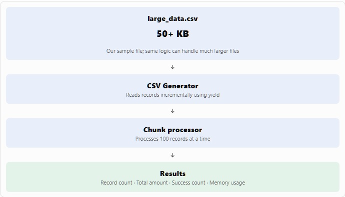

# Processing Large CSV Files Using Python Generators, Pandas & Polars

## 1. Architecture We Are Going to Build

**Goal:** Process a very large CSV file (potentially 1 TB) without loading the entire dataset into RAM.

### Architecture


```text
                 large_data.csv
                       |
                       v
              CSV Reader / Parser
                       |
                       v
             Generator (yield batches)
                       |
                       v
                Process a batch
                       |
              +--------+--------+
              |        |        |
              v        v        v
           Validate  Filter  Aggregate
              |        |        |
              +--------+--------+
                       |
                       v
              Update Running Totals
                       |
                       v
             Write Results Incrementally
                       |
                       v
                 Final Summary
```

### Core principles

1. Never load the entire 1 TB file into RAM.
2. Read records incrementally or in bounded batches.
3. Process one batch at a time.
4. Maintain only the required running totals.
5. Write output incrementally.
6. Include validation, logging, error handling and checkpointing.

**Important:** A generator helps produce data lazily. It does not automatically make the entire application memory-efficient. For example, converting a generator into `list()` can consume substantial memory.

---

## 2. Your Practice Files Are Ready

Keep the following files in your current project folder (`./`).

```text
your-project/
│
├── large_data.csv
├── process_large_csv.py
└── README.md
```

| File | Description |
|---|---|
| `large_data.csv` | Sample CSV dataset |
| `process_large_csv.py` | Generator-based chunk processing |
| `README.md` | Technical reference and interview preparation |

**Note:** The sample CSV is intentionally smaller than 1 TB so it can be tested locally. The implementation demonstrates the same incremental processing principle.

---

## 3. Execution Results

Sample execution:

| Metric | Result |
|---|---:|
| Total records | 1,800 |
| Chunk size | 100 |
| Number of chunks | 18 |
| Successful records | 558 |
| Peak traced Python memory | Approximately 185.78 KB |

### What did we achieve?

- Processed 1,800 records.
- Divided the records into 18 chunks.
- Processed only 100 records per chunk.
- Calculated successful record count and total amount.
- Avoided retaining the entire dataset in memory.

**Memory note:** The 185.78 KB figure comes from Python's `tracemalloc`. It measures traced Python allocations, not the complete operating-system process memory. Actual measurements may vary.

---

## 4. Generators vs Pandas DataFrame

### Python Generator

A generator is a Python feature that produces values lazily using `yield`.

Characteristics:

- Produces values only when requested.
- Does not need to retain all records in memory.
- Supports record-by-record or batch processing.
- Useful for custom streaming pipelines.

Example:

```python
def generate_numbers():
    for number in range(5):
        yield number

for number in generate_numbers():
    print(number)
```

### Pandas DataFrame

Pandas is a Python library used for tabular data manipulation and analysis.

Characteristics:

- Stores data in a DataFrame structure.
- Supports filtering, grouping, joining and aggregation.
- Provides vectorized operations.
- Convenient for analytical workloads.
- Full CSV loading can consume significant RAM.

Example:

```python
import pandas as pd

df = pd.read_csv("./large_data.csv")

print(df.head())
print(df["amount"].sum())
```

**Key difference:** Generators produce data incrementally, while a typical Pandas DataFrame holds the loaded data in memory.

---

## 5. Same Problem Using Both Approaches

### Problem Statement

Consider a CSV file containing:

```text
id,status,amount
1,SUCCESS,100.50
2,FAILED,25.00
3,SUCCESS,75.00
```

Our requirements:

1. Count records where status is `SUCCESS`.
2. Calculate the total amount for successful records.
3. Avoid loading the complete dataset into memory.

### Approach A: Python Generator

```python
import csv

def read_csv_in_chunks(file_path, chunk_size=100):

    with open(file_path, "r", newline="", encoding="utf-8") as csv_file:

        reader = csv.DictReader(csv_file)
        chunk = []

        for row in reader:

            chunk.append(row)

            if len(chunk) == chunk_size:
                yield chunk
                chunk = []

        if chunk:
            yield chunk


def process_file(file_path):

    success_count = 0
    success_amount = 0.0

    for chunk in read_csv_in_chunks(file_path, chunk_size=100):

        for row in chunk:

            if row["status"] == "SUCCESS":

                success_count += 1
                success_amount += float(row["amount"])

    print("Successful records:", success_count)
    print("Successful amount:", success_amount)


if __name__ == "__main__":
    process_file("./large_data.csv")
```

**Why choose this?**

- Processes data in batches.
- Retains only the current batch and running totals.
- Gives control over custom processing logic.
- Suitable for streaming pipelines.


```python
reader = csv.DictReader(csv_file)
csv.DictReader(file) # - does not load the entire CSV into a dictionary.
# It reads the CSV one row at a time and converts each row into a Python dictionary.

# Example CSV
# id,name,amount
# 1,Vinod,500
# 2,Rahul,700

with open("data.csv", newline="") as file:
    reader = csv.DictReader(file)

    for row in reader:
        print(row)

# Output :

{'id': '1', 'name': 'Vinod', 'amount': '500'}
{'id': '2', 'name': 'Rahul', 'amount': '700'}

```

**Important distinction:**
 - `csv.DictReader(file)` → Creates an iterator, not a complete dictionary.
 - `next(reader)` → Reads one row.
 - `for row in reader` → Reads rows sequentially.
 - `list(reader)` → Loads all rows into memory as a list of dictionaries. `[{},{}]` <br/>
That's why DictReader is useful for processing very large CSV files.


### Approach B: Pandas Full DataFrame

```python
import pandas as pd

df = pd.read_csv("./large_data.csv")

successful_rows = df[df["status"] == "SUCCESS"]

success_count = len(successful_rows)

success_amount = successful_rows["amount"].sum()

print("Successful records:", success_count)
print("Successful amount:", success_amount)
```

**Why choose this?**

- Simple and readable.
- Convenient for filtering and aggregation.
- Good when the dataset comfortably fits in RAM.

**Limitation:** Loading a 1 TB dataset into one DataFrame is not a practical default for a single machine.

### Approach C: Pandas with Chunks

```python
import pandas as pd

success_count = 0
success_amount = 0.0

for chunk in pd.read_csv("./large_data.csv", chunksize=100):

    successful_rows = chunk[chunk["status"] == "SUCCESS"]

    success_count += len(successful_rows)

    success_amount += successful_rows["amount"].sum()

print("Successful records:", success_count)
print("Successful amount:", success_amount)
```

**Why choose this?**

- Reads a limited number of rows at a time.
- Uses Pandas DataFrame operations.
- Avoids loading the complete CSV into memory.
- Suitable for large files when transformations can be processed batch by batch.

---

## 6. Can Pandas Also Handle a 1 TB File?

**Yes, conditionally!**

Pandas can process files larger than available RAM using chunked reading, provided the processing logic can work incrementally.

Example:

```python
import pandas as pd

for chunk in pd.read_csv("./large_data.csv", chunksize=100_000):

    # Process the current DataFrame chunk
    # Perform filtering and aggregation
    # Write results incrementally

    pass
```

### Important considerations

- Do not load the complete dataset into one DataFrame.
- Select chunk size based on available RAM and row width.
- Avoid accumulating all chunks in a list.
- Update running totals instead of retaining all records.
- Write output incrementally.
- Consider storage speed and processing time.

### Important limitation

Not every operation can be performed independently on chunks.

For example:

- Global sorting.
- Complex joins.
- Operations requiring information across the entire dataset.

These may need additional strategies, external storage, or distributed processing.

**Interview takeaway:** Pandas supports chunked reading. That does not mean every 1 TB operation will fit into memory or work efficiently on one machine.

---

## 7. Which Should You Choose?

| Scenario | Recommended approach | Reason |
|---|---|---|
| Custom record-by-record processing | Generators | Lazy processing and memory control |
| Dataset fits in RAM | Pandas DataFrame | Convenient analytics |
| Large CSV with batch-compatible transformations | Pandas chunksize | Bounded DataFrame processing |
| Large analytical queries | Polars | Lazy execution and query optimization |
| Workload exceeds one machine's capacity | Spark / PySpark | Distributed processing |

**Remember:** Do not choose based only on file size. Understand the transformation, memory requirements, performance and operational complexity.

---

## 8. What I Would Answer in My Next Interview

### Interview question:

**How would you process a 1 TB CSV file using Python?**

### Recommended answer:

I would first understand the file schema, required transformations, available memory and expected processing time.

I would avoid loading the complete file into a Pandas DataFrame because that could exceed available RAM.

For sequential processing, I would use Python's CSV reader with a generator to yield records or bounded batches.

I would process each batch, update running aggregates and write results incrementally without retaining all records in memory.

If the transformations are analytical, I could use Pandas `read_csv(chunksize=...)` to process bounded DataFrame chunks.

I would also evaluate Polars lazy scanning and streaming for supported operations.

If the workload exceeds a single machine's practical capacity or requires higher throughput, I would consider a distributed processing solution such as Spark.

For production, I would include:

- Schema validation.
- Logging and monitoring.
- Error handling.
- Checkpointing and recovery.
- Incremental output writing.

### Follow-up: Is `readline()` a generator?

No.

`readline()` reads one line when called. A file object is also iterable, so we can process it incrementally.

A generator function using `yield` allows us to package reusable streaming logic, such as yielding batches, and compose it with other processing steps.

### Follow-up: Does a generator always make processing faster?

No.

The main advantage of generators is lazy evaluation and controlled memory usage.

Python-level loops can be slower than vectorized Pandas operations. Performance depends on the processing workload.

---

## 9. Test Your Understanding

### Q1. You have a 1 TB CSV file and limited RAM. What is the best approach?

- A. `pd.read_csv("large_data.csv")` to load everything.
- B. Read and process records or bounded chunks incrementally.
- C. Convert the complete file into a Python list.

**Correct answer: B**

**Why?** Processes a limited amount of data at a time and controls memory usage.

**Why not A?** A full DataFrame may require more RAM than available.

**Why not C?** A list retains all records in memory and can consume even more memory.

### Q2. Your dataset fits comfortably in RAM and you need grouping, filtering and analysis. What should you choose?

- A. Pandas DataFrame.
- B. A custom generator for every operation.
- C. Read the file one character at a time.

**Correct answer: A**

**Why?** Pandas provides convenient and expressive vectorized analytical operations.

**Why not B?** Generators can work, but grouping and analytical operations may require more custom code and can be slower.

**Why not C?** Character-by-character reading adds unnecessary complexity.

### Q3. You need to process a large CSV using Pandas without loading it all at once. What should you use?

- A. `pd.read_csv()` without chunking.
- B. `pd.read_csv(..., chunksize=...)`.
- C. `df = list(pd.read_csv(...))`.

**Correct answer: B**

**Why?** It returns an iterator of DataFrame chunks that can be processed independently.

**Why not A?** It attempts to load the complete dataset.

**Why not C?** Collecting all chunks in a list defeats the memory benefit.

### Q4. You need to count successful records and sum their amounts. What is a good streaming design?

- A. Append all rows to a list and calculate at the end.
- B. Update running count and sum for each processed batch.
- C. Re-read the complete file for every row.

**Correct answer: B**

**Why?** Running aggregates retain only the small amount of state required for the result.

**Why not A?** Memory usage grows with the dataset size.

**Why not C?** It causes unnecessary repeated I/O and poor performance.

### Q5. Your workload is too large or slow for one machine. What should you consider?

- A. Increase the Python list size.
- B. Use a distributed processing framework such as Spark.
- C. Load all data into one Pandas DataFrame regardless of RAM.

**Correct answer: B**

**Why?** Distributed processing can divide suitable workloads across multiple machines.

**Why not A?** A larger list does not solve memory or throughput limitations.

**Why not C?** Ignoring memory limits can cause the process to fail.

---

## 10. Final Differences: Generators vs Pandas vs Polars

| Feature | Python Generators | Pandas | Polars |
|---|---|---|---|
| Type | Python language feature | DataFrame library | DataFrame library |
| Main purpose | Lazy iteration | Data analysis | Optimized analytical processing |
| Execution | On-demand values | Mostly eager DataFrame operations; chunked reading available | Eager and lazy APIs |
| Memory | Can remain low when processed incrementally | Full DataFrame can consume substantial RAM | Can be memory-efficient; streaming supported for suitable queries |
| Processing | Custom Python logic | Vectorized operations | Optimized columnar operations |
| Best use case | Streaming and custom pipelines | In-memory data analysis | Larger analytical queries |
| Main limitation | Python loops may be slower | Full-file loading may exceed RAM | Not every operation supports streaming |

### Optional: Polars Example

Polars supports lazy CSV scanning and query optimization.

```python
import polars as pl

query = (
    pl.scan_csv("./large_data.csv")
    .filter(pl.col("status") == "SUCCESS")
    .select(
        pl.len().alias("success_count"),
        pl.col("amount")
          .cast(pl.Float64)
          .sum()
          .alias("success_amount")
    )
)

result = query.collect(engine="streaming")

print(result)
```

### Why Polars?

- `scan_csv()` creates a lazy query instead of immediately loading the complete CSV into a DataFrame.
- The query engine can optimize the operations.
- Streaming execution can process supported queries in batches.
- Columnar processing is useful for analytical workloads.

**Important:** Not every Polars operation or query plan is guaranteed to stream. Verify the behavior with your Polars version and actual workload.

---

## Final Interview Takeaways

| Technology | Remember this |
|---|---|
| Generators | Lazy, incremental processing and custom streaming logic |
| Pandas | Convenient DataFrame analytics; use chunksize for large CSV processing |
| Polars | Lazy query optimization and streaming for supported analytical operations |
| Spark | Distributed processing across multiple machines |

### The most important point

**Generators are not always better than Pandas. Pandas is not always better than Polars.**

Choose the right technology based on:

1. Available memory.
2. Dataset size.
3. Type of transformation.
4. Processing performance.
5. Scalability requirements.
6. Reliability and recovery requirements.

**Interview mindset:** Explain why you choose an approach, what its limitations are, and how you would scale it in production.

<hr/>


# Large CSV File Processing – Python Generators vs Pandas

## Objective

Process large CSV files (potentially up to 1 TB) using two Python approaches:

1. Python Generators
2. Pandas DataFrame with chunked reading

Both approaches perform the same CRUD-style file-processing operations and produce comparable results.

## 1. Operations We Are Performing

| Operation | Implementation |
|---|---|
| Create | Create a processed output CSV file |
| Read | Read records from the input CSV |
| Update | Normalize status values using `strip().upper()` |
| Delete | Exclude records that do not have `SUCCESS` status |
| Write | Save successful records into a new CSV file |

**Note:** These are CRUD-style file-processing operations, not database CRUD transactions. The original CSV remains unchanged.

## 2. Project Structure

```text
project/
│
├── large_data.csv
├── generator_processing.py
├── pandas_processing.py
├── generator_output.csv
├── pandas_output.csv
└── README.md
```

| File | Purpose |
|---|---|
| `large_data.csv` | Original input dataset |
| `generator_processing.py` | Generator implementation |
| `pandas_processing.py` | Pandas implementation |
| `generator_output.csv` | Generator processing output |
| `pandas_output.csv` | Pandas processing output |

## 3. Execution Instructions

Install Pandas:

```bash
pip install pandas
```

Run Generator:

```bash
python generator_processing.py
```

Run Pandas:

```bash
python pandas_processing.py
```

Both scripts should be executed separately using the same input CSV file.

## 4. Metrics We Are Measuring

Each implementation reports the following metrics:

| Metric | Description |
|---|---|
| Original file size | Size of the input CSV |
| Output file size | Size of the processed CSV |
| Total records | Number of records read |
| Successful records | Number of records retained |
| Total successful amount | Sum of amounts for successful records |
| Current memory | Python-traced memory at measurement time |
| Peak memory | Highest traced allocation during execution |
| Memory released from peak | Difference between peak and current traced memory |
| Execution time | Total time taken from start to finish |

### Memory measurement

Both implementations use Python's built-in `tracemalloc` module.

```python
tracemalloc.start()

# Processing logic

current, peak = tracemalloc.get_traced_memory()

tracemalloc.stop()
```

Memory conversion:

```python
memory_mb = memory_bytes / (1024 ** 2)
```

**Important distinctions:**

- `current`: Memory currently traced by Python.
- `peak`: Highest traced memory allocation during processing.
- `peak - current`: Difference between peak and current traced memory.
- `tracemalloc` does not capture every native allocation made by libraries such as NumPy.

For actual process RAM usage, use `psutil` and monitor RSS (Resident Set Size).

For a reliable peak RAM comparison, run each approach in a separate process.

## 5. Generator Approach – Expected Behaviour

The generator reads CSV records incrementally using `yield`.

Processing sequence:

1. Open the CSV file.
2. Read records incrementally.
3. Yield a batch of records.
4. Normalize status.
5. Filter successful records.
6. Calculate successful record count and total amount.
7. Write successful records into the output CSV.
8. Release the processed batch.
9. Continue until the file ends.

### Advantages

- Incremental processing.
- Controlled memory consumption.
- Suitable for custom processing pipelines.
- No need to retain the entire dataset.
- Can process files larger than available RAM.

### Limitations

- Python-level loops can be slower than vectorized operations.
- More custom processing logic may be required.
- Batch size must be selected carefully.

## 6. Pandas Approach – Expected Behaviour

The Pandas implementation uses:

```python
pd.read_csv(INPUT_FILE, chunksize=10000)
```

Processing sequence:

1. Open the CSV file.
2. Read a bounded DataFrame chunk.
3. Normalize status.
4. Filter successful records.
5. Calculate successful record count and total amount.
6. Write successful records to the output CSV.
7. Release the current DataFrame and filtered DataFrame.
8. Read the next chunk.
9. Continue until the file ends.

### Advantages

- Convenient DataFrame operations.
- Vectorized filtering and aggregation.
- Less custom row-processing code.
- Chunked reading avoids loading the entire dataset.

### Limitations

- DataFrames can consume substantial memory.
- Filtering creates additional DataFrame allocations.
- Chunk size affects memory and execution time.
- Operations requiring global sorting or complex joins may need additional strategies.

## 7. Generator vs Pandas – Comparison

| Feature | Generator | Pandas |
|---|---|---|
| Reading | Incremental records/batches | DataFrame chunks |
| Processing | Python loops | Vectorized operations |
| Memory | Generally low and bounded | Bounded by chunk size and intermediate DataFrames |
| Performance | Depends on Python processing logic | Often faster for analytical operations |
| Filtering | Manual conditions | DataFrame filtering |
| Aggregation | Running variables | Built-in aggregation |
| Large files | Suitable | Suitable with chunked reading |
| Full-file loading | Not required | Not required when using chunksize |

## 8. Can Both Approaches Process a 1 TB File?

**Yes, potentially.**

Neither approach requires loading the entire CSV into memory when implemented incrementally.

However, actual feasibility depends on:

- Available RAM.
- Storage throughput.
- CPU performance.
- CSV row width and data types.
- Transformation complexity.
- Output size.
- Processing time requirements.

For a 1 TB workload, benchmark the actual processing requirements.

If the workload exceeds one machine's practical capacity, consider distributed processing using Apache Spark / PySpark.

## 9. How to Compare Both Approaches Correctly

For a fair comparison:

1. Use exactly the same input CSV.
2. Use identical filtering and aggregation logic.
3. Use the same output columns.
4. Run each implementation separately.
5. Measure execution time.
6. Measure peak traced memory.
7. Measure process RSS for actual RAM usage.
8. Compare output record counts and total amounts.

### Comparison table – Fill after execution

| Metric | Generator | Pandas |
|---|---:|---:|
| Original file size | | |
| Output file size | | |
| Total records | | |
| Successful records | | |
| Total successful amount | | |
| Current traced memory | | |
| Peak traced memory | | |
| Peak process RSS | | |
| Execution time | | |

**Validation:** Both approaches should produce the same successful record count and total successful amount. Their output contents should also match.

## 10. Interview Takeaways

**Question: How would you process a 1 TB CSV file?**

I would avoid loading the entire dataset into memory.

For sequential processing, I would use generators with incremental CSV reading and bounded batches.

For analytical transformations, I would use Pandas `read_csv(chunksize=...)` to process DataFrame chunks.

I would measure memory, execution time and processing throughput to identify the best approach.

If the workload exceeds one machine's capacity, I would consider Spark or another distributed processing solution.

### Remember

- Generator: Lazy and incremental processing.
- Pandas: Convenient analytical operations and chunked DataFrame processing.
- Both: Can process data larger than RAM when operations are designed for bounded memory.
- Spark: Consider for distributed processing at larger scale.

**Final principle:** Choose the approach based on memory requirements, processing complexity, performance and scalability – not simply the file size.
